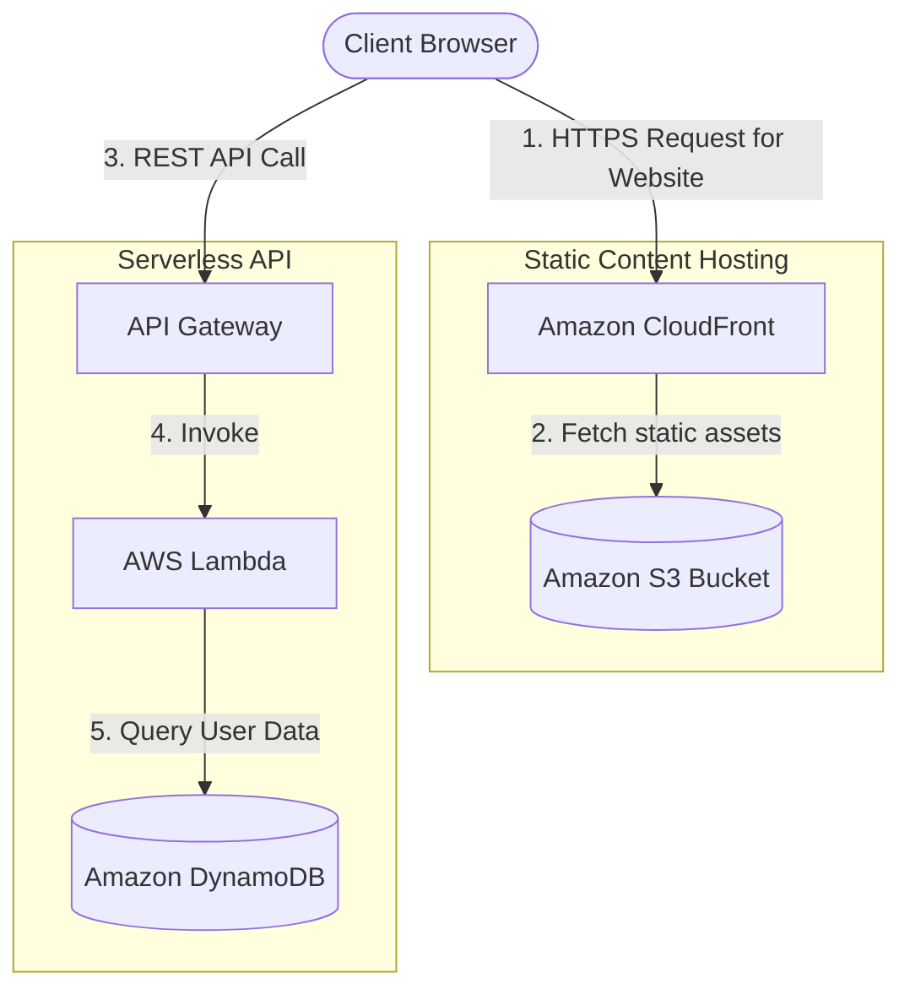

# E-Commerce AWS Serverless Infrastructure

This repository contains the infrastructure and code for an e-commerce backend built on AWS using a serverless architecture.

## Architecture



The project provisions the following AWS resources:
*   **S3 Bucket:** Hosts the static frontend files (HTML, CSS, JS).
*   **CloudFront Distribution:** A Content Delivery Network (CDN) to securely serve the static assets from the S3 bucket via HTTPS.
*   **Amazon API Gateway:** Exposes a RESTful API endpoint (`/users`) to communicate with the backend.
*   **AWS Lambda:** A serverless function (Node.js) that handles the business logic, retrieving data from DynamoDB based on the API Gateway requests.
*   **Amazon DynamoDB:** A NoSQL database table (`users_data`) used to store user information.

## Directory Structure

*   `infrastructure/`
    *   `infrustructure.py`: Python script using `boto3` to provision the entire AWS infrastructure from scratch.
    *   `teardown.py`: Python script to delete the provisioned AWS resources (cleanup).
*   `webpage/`: Contains the static frontend code (`index.html`, `style.css`, `script.js`).
*   `index.mjs`: The AWS Lambda function handler code.
*   `upload.py`: A utility script to quickly upload the frontend files to the S3 bucket.
*   Terraform files (`*.tf`): Alternative infrastructure as code definitions for the project.

## Setup Instructions

### 1. Provision Infrastructure
Run the Python script to create all AWS resources. Ensure your AWS credentials are appropriately configured (`~/.aws/credentials`).
```bash
cd infrastructure
python3 infrustructure.py
```
This will output your API Gateway URL and your CloudFront Domain Name.

### 2. Update Frontend Configuration
Update the fetch URL in `webpage/script.js` with your new API Gateway URL.

### 3. Upload Frontend to S3
Run the upload script to push your website files to the newly created S3 bucket.
```bash
python3 upload.py
```

### 4. Cleanup
To avoid incurring unnecessary AWS costs, you can destroy all provisioned resources (except IAM roles) by running:
```bash
cd infrastructure
python3 teardown.py
```
